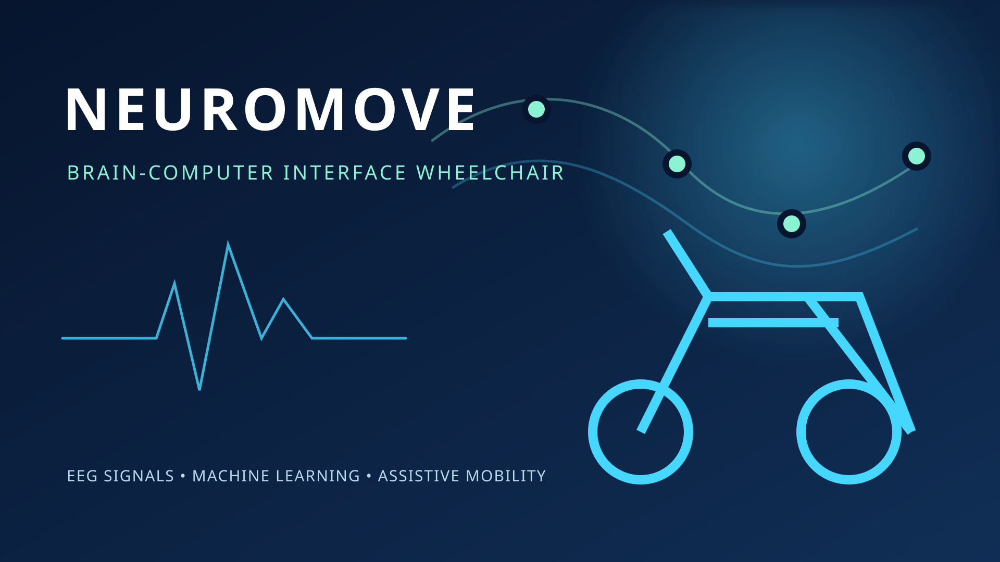

# NeuroMove

NeuroMove is an assistive brain-computer interface (BCI) wheelchair controller. It combines EEG signal processing and an SVM classifier with a desktop control panel and an ESP32-powered wheelchair.



## What it does

- Preprocesses EEG recordings and extracts common spatial pattern (CSP) features.
- Trains and evaluates an SVM model for directional wheelchair commands.
- Provides manual keyboard/button control and automated dataset-driven BCI mode.
- Displays reconstructed EEG activity, prediction confidence, and live accuracy.
- Sends movement commands to an ESP32 over Bluetooth RFCOMM.

## Project structure

| File or directory | Purpose |
| --- | --- |
| `bci_gui_advanced.py` | Hybrid manual and automated BCI desktop GUI |
| `eeg_preprocessing.py` | EEG loading and feature preparation |
| `train_svm.py` | Model training and evaluation |
| `bci_dataset_bt.py` | Bluetooth dataset control workflow |
| `BCI_Wheelchair_ESP32_V2.ino` | ESP32 wheelchair firmware |
| `models/` | Trained SVM, scaler, CSP, and class-mapping artifacts |
| `eeg_dataset/` | EEG recordings used by the training workflow |

## Requirements

- Python 3.10+
- Linux with Bluetooth RFCOMM support for hardware control
- ESP32 wheelchair hardware running `BCI_Wheelchair_ESP32_V2.ino`

Install the Python dependencies:

```bash
python -m venv .venv
source .venv/bin/activate
pip install -r requirements.txt
```

## Usage

Train or regenerate the model artifacts when needed:

```bash
python train_svm.py
```

Launch the advanced controller:

```bash
python bci_gui_advanced.py
```

The GUI starts in manual mode. Use the on-screen controls or arrow keys for manual movement, then enable Auto BCI mode to step through the prepared EEG feature dataset and send predicted commands to the ESP32.

The Bluetooth address is configured near the top of `bci_gui_advanced.py` in `ESP32_BT_MAC`. Update it for your hardware before connecting.

## Safety

This is a research and educational prototype, not a certified medical device. Test with the wheelchair lifted or otherwise secured, keep a physical emergency stop available, and validate every command before use with a person.

## License

No license has been specified yet. Add a license file before distributing the project.
